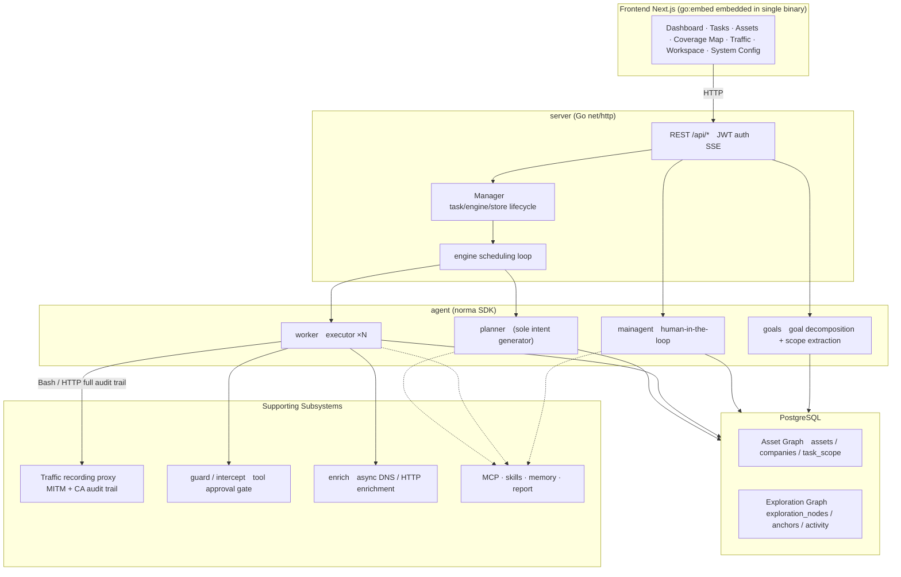
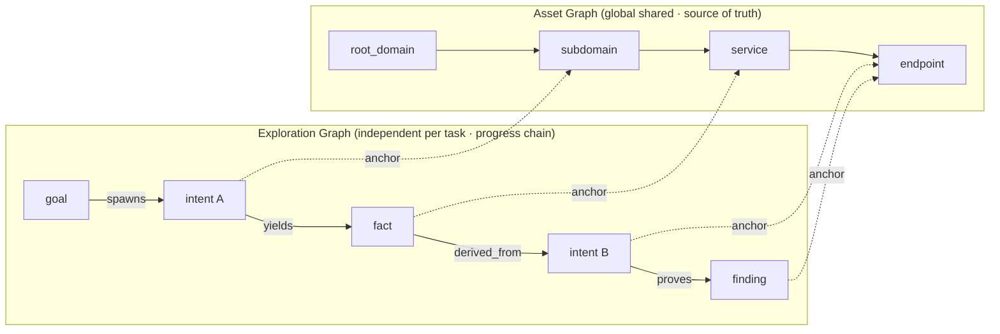
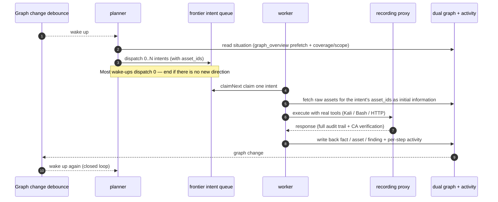
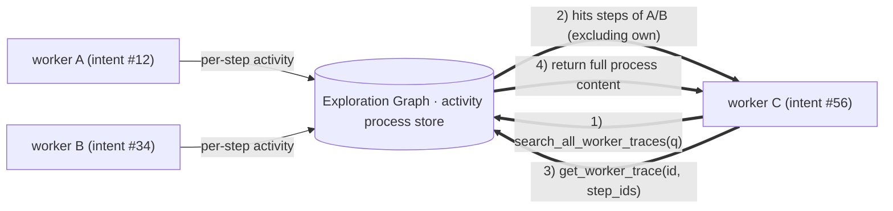
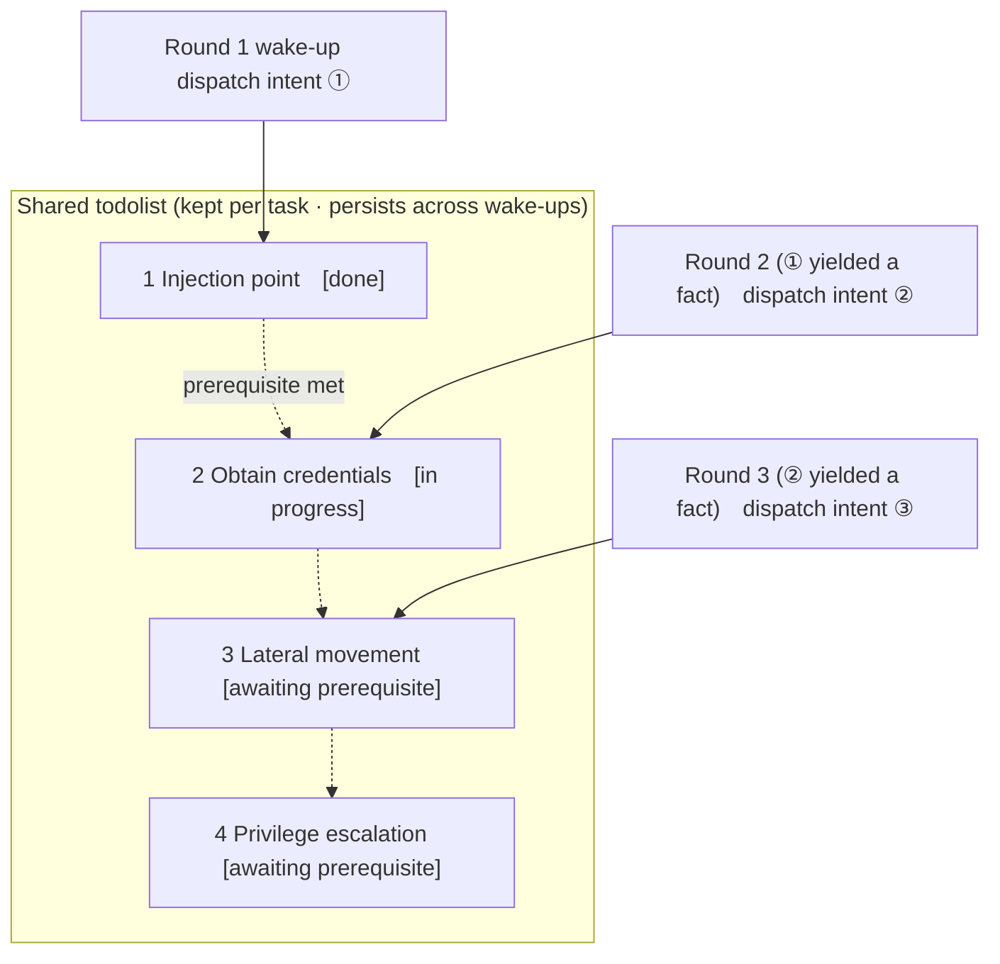

<div align="center">

# ARTEX

### LLM Multi-Agent Autonomous Penetration Testing Platform for Authorized Security Assessments

Go monolithic backend · Next.js frontend · PostgreSQL · Asset Graph / Exploration Graph dual-graph driven

**Version baseline: official ARTEX 0.3.7 release line (0.3.7 released on 2026-08-31)**

[What this fork changes](#what-this-fork-changes) · [Choosing an environment](#choosing-an-environment) · [Installation](#installation) · [HexBrain and HexStrike](#optional-integrations-hexbrain-and-hexstrike) · [Tuning](#tuning-for-deeper-runs) · [Architecture](#system-technical-architecture) · [Changelog](CHANGELOG.md) · [License](#license-and-disclaimer)

</div>

---

> **About this fork**: This repository is an English edition of [Core-RCE/ARTEX-original-version](https://github.com/Core-RCE/ARTEX-original-version). It translates the whole platform to English (2026-11-19) and then adds result-quality, safety, and deployment improvements, listed in [What this fork changes](#what-this-fork-changes) and in the [CHANGELOG](CHANGELOG.md). Chinese is kept only where code matches against it: quota-error phrases returned by Chinese LLM providers, ICP filing-number parsing, CJK test fixtures, and references to Chinese-named doc files.
>
> The published `autumn27/artex` Docker image is the upstream Chinese build. To run this fork in Docker, build the image from this repository with `scripts/build-image.sh` (see [Installation](#installation)).
>
> **Version note**: The current checkout is `v0.3.7-10-gdc46457`, i.e. 10 official upstream commits after the `v0.3.7` tag. It is not a byte-for-byte identical snapshot of the `v0.3.7` tag.
>
> **Source status**: This repository holds a copy of the source code that ARTEX officially published before it went closed-source, and the **GNU AGPL v3.0** open-source license granted when that copy was obtained continues to apply. The official decision to stop publishing source code later does not retroactively revoke the open-source license of older versions that were lawfully obtained. See [LICENSE](LICENSE) for the full terms and [THIRD_PARTY_NOTICES.md](THIRD_PARTY_NOTICES.md) for third-party component notices.

## Screenshot Preview

| Dashboard (Overview / Token Usage / Activity Feed) | Task List |
| :---: | :---: |
|  |  |

| Task · Execution Process (Sessions / Tool Invocations) | Exploration Chain |
| :---: | :---: |
|  |  |

| Findings | Assets |
| :---: | :---: |
|  |  |

| Asset Coverage Map (force-directed layout · tested highlighting · node collapse/expand) |
| :---: |
|  |

| Traffic Recording | Human-in-the-Loop Chat |
| :---: | :---: |
|  |  |

| Agent Management | LLM Configuration |
| :---: | :---: |
|  |  |

| Interception Approval | Backend Logs |
| :---: | :---: |
|  |  |


---

## What this fork changes

Everything below is on top of the upstream code. None of it weakens scope handling, the command intercept rules, or the approval flow.

### Fewer false positives, more verified findings

- **Evidence is required to report a vulnerability.** `report_finding` now rejects a finding with no reproducible evidence (the exact request or command plus the output line that proves it) and tells the agent to record an unverified suspicion as a fact instead. Previously an LLM guess was stored as "confirmed".
- **Severity is validated.** Values are normalized to `critical / high / medium / low`; anything else is rejected instead of silently falling out of the severity counts.
- **Duplicate findings are refused.** Re-reporting the same vulnerability class and name on exactly the same assets returns the existing finding instead of creating another row. Different parameters or endpoints stay separate findings.
- **High-impact findings get an independent re-test.** Before a critical or high finding closes a goal, the planner dispatches one verification intent that reproduces it from a fresh session, ideally with a different tool, unless the evidence is unambiguous on its own (a captured flag, output from achieved code execution).
- **A tool failure is no longer a negative result.** Workers retry a failed, missing, or rate-limited tool once with adjusted options or an equivalent tool, and otherwise record the surface as *untested*, so the planner does not treat it as clean.
- **The client report respects triage.** Findings marked false positive, duplicate, or ignored are left out; the report adds per-severity counts, each finding's review status, and the reporter agent's detailed write-up.

### Longer, steadier runs

- The end-of-round prompt no longer contradicts the "never stall" rule, which could leave a task idle until the next heartbeat.
- The planner sees the last 30 finished intents (was 15), so long tasks stop re-dispatching work that scrolled out of view.
- New installs give each worker run 30 minutes (was 20), so deep exploitation chains are cut off less often.

### New testing skills

Shipped and enabled for the `worker`, `pentest`, and `auto` agents: `access-control-idor`, `auth-session-testing`, `ssrf-testing`, `file-upload-testing`, `subdomain-takeover-cloud`. Each is verification-first, non-destructive, and ends with an evidence checklist and common false positives. `hexbrain-research` ships disabled; see [HexBrain](#hexbrain-recommended-optional-research-only).

### Safety and correctness

- **Intercept rules now cover MCP tools.** Previously only built-in tools (Bash, WebFetch, file edits) were checked, so a command run through an MCP server bypassed every deny rule. `mcp__*` is now on by default; use `mcp__<server>__*` for a single server.
- **MCP calls**: long remote scans get 15 minutes (the old fixed limit was 120 seconds), and output is capped at 40 KB so one result cannot flood the model's context.
- **Docker publishes ports on localhost only by default** (`ARTEX_BIND`), because the first visitor to a fresh install sets the admin password and port 8788 is a recording proxy.
- **The login signing key survives container rebuilds** (`-keydir` / `ARTEX_KEY_DIR`), so updates no longer log everyone out.
- **Native Windows**: interactive-shell tools (which cannot work there) are no longer offered, and agents are told their shell is PowerShell.
- **Upgrades from the Chinese release** switch built-in prompts and tool descriptions that are still in Chinese to the English defaults. Previous prompt versions stay in each agent's prompt history.

---

## Choosing an environment

ARTEX's agents do their work by running security tools in a shell, so the environment matters more than for most web apps.

| Environment | Verdict | Why |
| --- | --- | --- |
| **Docker, Kali image** (`artex:kali`) | **Recommended** | Isolated from your host, reproducible, and ships nmap, masscan, nuclei, httpx, subfinder, ffuf, feroxbuster, gobuster, sqlmap, nikto, whatweb, wafw00f, hydra, SecLists, and searchsploit. |
| **Kali Linux, native** | Recommended for a dedicated VM | All tools at full speed, raw-socket scans without container networking, and stdio MCP servers such as HexStrike run alongside ARTEX. Use a VM you can reset. |
| Docker, slim image (`artex:local`) | Fine for recon-only use | Small image with nmap, curl, dig, and Playwright; agents must install anything else themselves. |
| Windows via **WSL2** | Good on a Windows workstation | Run the Kali Docker image with Docker Desktop's WSL2 backend, or install Kali in WSL2 and follow the native steps. |
| Windows, native | Not recommended | Commands run through PowerShell, interactive shells are unavailable, most tools are missing, and the helper scripts are bash-only. |

---

## Asset Sync (ScopeSentry)

Asset data can be synced directly from [ScopeSentry](https://github.com/Autumn-27/ScopeSentry), saving you from collecting it again:

- On the "**Asset Sync**" page, enter the ScopeSentry address and API Key to connect the data source;
- Choose the targets and asset types to sync (domain / subdomain / IP / port / site / endpoint…) by **project** or **task**;
- Import with one click and merge by company asset scope, feeding directly into ARTEX's Asset Graph for agents to explore.

---

## Installation

> Requires **PostgreSQL 16** and an **LLM** (`ANTHROPIC_API_KEY` or `OPENAI_API_KEY`, or configure a profile in the UI). Only test systems you are authorized to test.

### Method 1: Docker with the Kali toolset (recommended)

```bash
git clone https://github.com/zizz7/ARTEX-English.git
cd ARTEX-English
cp .env.example .env                  # set POSTGRES_PASSWORD (and optionally an API key)
scripts/build-image.sh kali           # builds artex:kali from this repo
docker compose -f docker-compose.yml -f docker-compose.kali.yml up -d
# → http://127.0.0.1:8787  (first visit: /setup to set the admin password)
```

`build-image.sh` compiles the web UI and the Go binary on your machine when Node 20+ and Go 1.26+ are installed, and otherwise inside the official `node` and `golang` containers, so Docker alone is enough. The Kali image is large (about 4 GB) because it includes the toolset and SecLists. `kalilinux/kali-rolling` is not pinned, so two builds on different days can differ.

Or run `./install.sh`, choose **① All Docker**, and set `ARTEX_FLAVOR=kali` first to get the Kali image (`ARTEX_FLAVOR=kali ./install.sh`).

### Method 2: Docker, slim image

```bash
cp .env.example .env
scripts/build-image.sh                # builds artex:local (Dockerfile)
docker compose up -d
```

The slim image has ripgrep, curl, nmap, dig, netcat, whois, Node, and Playwright with Chromium.

**Both Docker methods**: the UI (8787) and the recording proxy (8788) are published on `127.0.0.1` only. Set `ARTEX_BIND=0.0.0.0` in `.env` only behind a firewall or a TLS reverse proxy, because the first visitor to a fresh install sets the admin password. `./data`, `./keys`, and `./skills` are bind-mounted and survive rebuilds.

### Method 3: Kali Linux, native (systemd)

```bash
git clone https://github.com/zizz7/ARTEX-English.git
cd ARTEX-English
# build the single binary (needs Go 1.26+ and Node 20+)
cd web && npm ci && npm run build:static && cd ..
rm -rf server/webui/dist && cp -r web/out server/webui/dist
CGO_ENABLED=0 go build -tags embedui -o artex ./cmd/artex
sudo scripts/install-kali.sh          # apt toolset + PostgreSQL + config.json + systemd unit
sudo systemctl enable --now artex
# → http://127.0.0.1:8787  (remote: ssh -L 8787:127.0.0.1:8787 user@kali-host)
```

`install-kali.sh` installs the same toolset as the Kali image plus PostgreSQL. It creates an `artex` database role with a random password and writes `/opt/artex/config.json` (mode 600). It also installs `deploy/artex.service`, which runs ARTEX as a dedicated `artex` user, bound to localhost, with the `CAP_NET_RAW`/`CAP_NET_ADMIN` capabilities that nmap and masscan need for raw scans. If you run it again, it keeps an existing `config.json`.

### Method 4: Windows

Use **WSL2**. Either install Docker Desktop with the WSL2 backend and follow Method 1, or install Kali from the Microsoft Store (`wsl --install -d kali-linux`) and follow Method 3 inside it. WSL2 forwards `localhost`, so the UI opens in your Windows browser.

Native Windows works only for light use. Commands run through PowerShell, interactive shells are unavailable, and you must install the tools yourself.

### Method 5: Build from source / development

```bash
cd web && npm ci && npm run build:static && cd ..
rm -rf server/webui/dist && cp -r web/out server/webui/dist
CGO_ENABLED=0 go build -tags embedui -o artex ./cmd/artex
./artex -addr 127.0.0.1:8787 -proxy 127.0.0.1:8788
```

`./build.sh --release` builds zip archives for Linux, macOS, and Windows (see `./build.sh --help`).

---

## Updating and Upgrading

> An upgrade only replaces the program; your data stays. The Postgres volume `pgdata`, `./data`, `./keys`, and `./skills` are preserved. **No manual database migration is needed**: on every startup `artex` idempotently re-applies `schema.sql` and runs one-time migrations. It is still wise to back up `./data` and the database first.

```bash
git pull
./update.sh                              # ① Docker: rebuilds the image from the new code and recreates artex
ARTEX_FLAVOR=kali ./update.sh            # same, for the Kali image
```

For a native install, rebuild the binary (Method 3 or 5), then `sudo install -o artex -g artex -m 755 artex /opt/artex/artex && sudo systemctl restart artex`.

**Upgrading from the upstream Chinese release**: on first start, built-in agent prompts and tool descriptions that are still in Chinese are switched to the English defaults. The old prompt versions stay in each agent's prompt history (Agents page). The built-in intercept rules are seeded by name, so an old database keeps the Chinese-named rules next to the new English ones; delete whichever set you don't want on the Intercept Rules page.

---

## Configuration

**Database** (`config.json`, or the `ARTEX_PG_DSN` environment variable, which takes priority):

```json
{
  "database": {
    "host": "127.0.0.1", "port": 5432,
    "user": "artex", "password": "yourpass",
    "dbname": "artex", "sslmode": "disable"
  }
}
```

**LLM**: `export ANTHROPIC_API_KEY=sk-...` (or `OPENAI_API_KEY`), or add a profile on the LLM page.
Optional: `ARTEX_LLM_PROVIDER` / `ARTEX_LLM_MODEL` / `ARTEX_LLM_BASE_URL` / `ARTEX_LLM_PROXY`.

**Flags and environment**:

| Flag / variable | Default | Purpose |
| --- | --- | --- |
| `-addr` | `:8787` | UI + API listen address (use `127.0.0.1:8787` outside Docker) |
| `-proxy` | `:8788` | Traffic recording proxy (empty disables it) |
| `-data` | `data/` next to the binary | Workspace and traffic index |
| `-keydir` / `ARTEX_KEY_DIR` | next to the binary | JWT signing key; keep it outside `-data` so the file manager can never serve it |
| `ARTEX_BIND` (compose) | `127.0.0.1` | Interface Docker publishes 8787/8788 on |
| `ARTEX_IMAGE` (compose) | `artex:local` | Image the `artex` service runs |

---

## Optional integrations: HexBrain and HexStrike

ARTEX can use external MCP servers (System → MCP; `stdio` and Streamable `http` transports). Here is a straight assessment of two that come up often.

### HexBrain (recommended, optional, research only)

HexBrain is a hosted, read-only MCP that returns publicly disclosed HackerOne reports, payload references, testing playbooks, and CVE checks. It fits ARTEX well because it improves planning without executing anything.

- **Benefits**: better test ideas per technology and bug class, payloads with known track records, a "was this accepted before?" check before reporting, and CVE leads once the stack is fingerprinted.
- **Costs**: every query leaves your machine. Do not send client-confidential details (internal hostnames, credentials, unreleased product names); query by technology and bug class. Report text is third-party content that reaches the model, which is a prompt-injection surface. A CVE match is a lead, not a finding.
- **Setup**: add an MCP server named exactly `hexbrain` (transport `http`, the URL and `Authorization` header from your HexBrain account). Then make the `hexbrain-research` skill visible to the `worker` and `pentest` agents. The skill declares `mcps: hexbrain`, so the tools only appear once the skill is loaded, and it tells the agent how to use them safely.

### HexStrike AI (not bundled; connect only if you need it)

[HexStrike AI](https://github.com/0x4m4/hexstrike-ai) wraps about 150 offensive tools behind its own API server (port 8888 by default), which runs the tools itself and includes an endpoint that executes arbitrary commands. Its README describes no authentication and suggests adding it for production deployments. It was also widely reported in September 2025 as being used by criminals to speed up exploitation of Citrix NetScaler flaws.

ARTEX already runs real tools through its own shell, where commands are recorded, routed through the traffic proxy, and checked by the intercept rules. HexStrike mostly duplicates that, and its tools run outside ARTEX's traffic recording and workspace. **Recommendation: use the Kali image or a native Kali install instead of HexStrike.** If you still want it:

1. Run `hexstrike_server.py` on the same machine, bound to localhost (firewall port 8888 from everything else).
2. Add an MCP server named `hexstrike` with transport `stdio` and the command `python3 /path/to/hexstrike_mcp.py --server http://127.0.0.1:8888`. The stdio client must run where ARTEX runs, which is easiest on a native Kali install.
3. Keep `mcp__*` (or `mcp__hexstrike__*`) in the intercept tool list (the default), so the deny rules also check HexStrike's tool arguments. Consider enabling the LLM fallback judge for unmatched calls.
4. Make it visible to the `worker` agent only.

---

## Tuning for deeper runs

| Setting | Where | Effect |
| --- | --- | --- |
| Workers per task (default 3) | System Settings | More parallel exploration; raise it only if your LLM rate limits allow |
| Worker run budget (30 min on new installs) | Agents → worker | Longer single-intent exploitation chains |
| LLM failover | LLM page | Without a second profile, a long run stops on the first quota or billing error |
| Installed tools | Tools → add a `shell` tool | Lists extra CLI tools in Bash's description so agents know they exist |
| LLM fallback judge | Intercept Rules | Reviews tool calls that match no rule; costs one LLM call per such call |

Improvements in this fork were verified by building and testing the code (the Go test suite against a real PostgreSQL, the frontend type check, and a startup smoke test of the Kali image). They have not been benchmarked on live targets, so measure on your own authorized lab before relying on comparative claims.

---

## Development

```bash
./dev.sh    # Backend (:8787) + traffic proxy (:8788) + frontend next dev (:5173) → http://localhost:5173
```

- Backend: `go run ./cmd/artex` (without `-tags embedui` the frontend is not embedded)
- Frontend: `cd web && npm run dev` (`/api` is reverse-proxied to the backend, with hot reload)
- Tests: `go test ./...`
- Mock preview (no backend): `cd web && NEXT_PUBLIC_MOCK=1 npm run dev`

---

## System Technical Architecture

ARTEX is an **autonomous penetration testing system driven by multiple LLM agents**: a Go monolithic backend (with the Next.js frontend embedded) + PostgreSQL, with agent capabilities provided by the [`norma`](https://github.com/Autumn-27/norma) SDK (`agentcore` / `tool` / `permission` / `harness` / `memory` / `transcript`). At its core is the **dual-graph architecture**, along with two autonomy mechanisms built around it: **process-level information exchange between workers** and the **planner's multi-round shared todolist for stable attack chains**.

### Overall Layering



| Layer | Responsibility |
| --- | --- |
| **Frontend** | Next.js static export, embedded into the single binary via `go:embed`; visualizes tasks / assets / exploration chains / coverage map, with human-in-the-loop chat |
| **server** | `net/http` routing + JWT auth + SSE; `Manager` hosts the lifecycle of tasks, engines, and DB stores |
| **engine** | One `plannerLoop` + N worker goroutines per task; intent claiming, timeout/pause/drain |
| **agent** | goals / planner / worker / mainagent; `ToolSet` exposes the dual graph as LLM tools |
| **db** | Postgres persistence of the dual graph (pgx); the schema is created idempotently on every startup via `go:embed` |
| **Supporting** | Recording MITM proxy, approval gate, async enrichment, MCP/skills/memory/reports |

### Dual-Graph Architecture: Exploration Graph + Asset Graph

The system splits "**what the target is**" and "**how far it has been tested**" into two independent graphs that are connected through anchors:

- **Asset Graph (global, shared)**: A single source of truth for assets shared across tasks. Nodes are `root_domain / subdomain / ip / service / app / endpoint`, and belong to a company; the parent-child relationships (domain → subdomain → service → endpoint) and deduplication keys are all computed by the program, while agents only submit raw information.
- **Exploration Graph (independent per task)**: The "thinking and progress" process of a single task. Nodes are `goal / intent / fact / finding / hint`, connected by edges such as `spawns / derived_from / yields / proves` into a **lineage chain**, answering "which direction was derived from which facts, and what did it produce".
- **The two graphs are connected by anchors**: `exploration_anchors(node_id, asset_id)` anchors intents / facts / findings to specific assets. This lets you see, from an "exploration direction", which assets it targeted, and also, from a given asset, look up which intents tested it in this task and which facts were derived. This also underpins **asset test coverage** and the **Asset Coverage Map** (in-scope assets + tested highlighting).



> Division of labor: the **planner** reads the situation from the Exploration Graph, judges the goal, and only dispatches **intents** into the frontier when there is a new, uncovered direction; a **worker** claims **one intent**, executes it with real tools, writes the new assets/facts/findings back to both graphs, and then stops. The Asset Graph is shared fact; the Exploration Graph is the per-task progress chain.

### Engine and Intent Lifecycle (the Closed Loop of One Exploration)

The engine is an **event-driven** closed loop: as soon as the graph changes, the planner is woken up; the planner dispatches intents, workers claim and execute them and write back, and the write-back triggers the next round, until the goal is proven (`prove_goal`).



### Process-Level Information Exchange Between Workers

In a deep exploration, many valuable observations (an error message, a response snippet, a hidden parameter) appear during one worker's **execution process** without necessarily being written up as a formal fact. To avoid duplicated effort and let workers along the chain stand on each other's shoulders, workers can **search across work processes**:

- `search_all_worker_traces(q)`: search by keyword within the **execution processes of other works in this task** (automatically excluding the steps of the worker's own intent); hits carry an `intent_id`;
- `list_worker_traces` / `get_worker_trace(intent_id, step_ids=[…])`: first see which works have run, then fetch the full content of specific steps of a given work for detailed exchange.

This way, even if the Exploration Graph has no corresponding fact yet, later workers can reuse observations from other workers' processes: **information flows between workers at the granularity of the "execution process"**, while the boundary is unchanged (each worker still only does the one intent it claimed).



### Planner Multi-Round Shared Todolist → Stable Attack Chains

Real attack chains are often **multi-step sequences with dependencies** (e.g. find an injection point → obtain credentials → lateral movement → privilege escalation), and dispatching them all in parallel at once just makes a mess. The planner therefore holds a **planning todolist that is kept per task and shared across wake-ups**:

- The planner is event-driven: it is woken up whenever the graph changes, but **every wake-up is a brand-new session**. The shared todolist lets it **record a serial exploitation chain once**, then **dispatch intents step by step according to dependencies** over subsequent rounds, rather than expanding the entire chain up front in a single round;
- Each round, it dispatches an intent only for the next step whose "prerequisite steps are complete and whose dependent facts already exist", and updates the list as progress is made (marking steps already satisfied by facts as complete).



As a result, even in an "event-driven + stateless session" environment, the attack chain still **advances stably, without repetition or misordering**. This is the key to ARTEX being able to autonomously complete multi-step exploitation chains.

---
## References

https://github.com/oritera/Cairn


## License and Disclaimer

### Open-Source License

This project is licensed under the **GNU Affero General Public License v3.0 (AGPL-3.0)**. See the [LICENSE](https://github.com/mhtsec/ARTEX/blob/main/LICENSE) file in the repository root for the full terms.

This means anyone may freely use, modify, and distribute this project, but **derivative works must likewise be open-sourced under AGPL-3.0**; in particular, **if you modify this project and provide it to users over a network (e.g. deployed as an online service), you must also make the corresponding complete source code available to those users**.

> ⚠️ **Important notice**: The open-source license itself does not restrict how the software is used. The "Usage Restrictions" and "Disclaimer" below are additional terms and a formal statement from the author to users. Please be sure to comply with them.

**ARTEX is intended solely for personal learning, code research, and local technical verification. It must not be used to launch actual tests against any online system or website.**

### Permitted Use

- It may only be used to **read, study, and research the source code of this project**, and to perform technical principle verification in a **local, isolated environment**;
- It is suitable for non-offensive purposes such as personal learning, academic research, and code review.

### Prohibited Activities

- **It is strictly forbidden to use this tool to scan, probe, exploit, or attack any website, online service, or networked system** (regardless of whether authorization has been obtained or whether the assets are your own);
- It is strictly forbidden to use this tool for any actual penetration testing, offensive/defensive exercises, or production environments;
- It is strictly forbidden to use this tool for illegal intrusion, data theft, extortion, denial of service, or any destructive or criminal activity;
- It is strictly forbidden to use this tool to engage in conduct that violates the laws and regulations of your country/region.

### Compliance Responsibility

Users must comply on their own with all laws and regulations of their country/region regarding cybersecurity, data protection, and computer crime (in mainland China, including but not limited to the Cybersecurity Law, the Data Security Law, the Personal Information Protection Law, and related judicial interpretations). **All legal liability and consequences arising from the use of this tool are borne solely by the user.**

### Disclaimer

This project is provided "AS IS", without any express or implied warranty. The author and contributors shall not be liable for any direct or indirect loss, data loss, system damage, or legal dispute arising from the use of this tool (whether or not it is used properly). **By downloading, installing, or using this project, you acknowledge that you have read, understood, and agreed to all of the above terms.**
