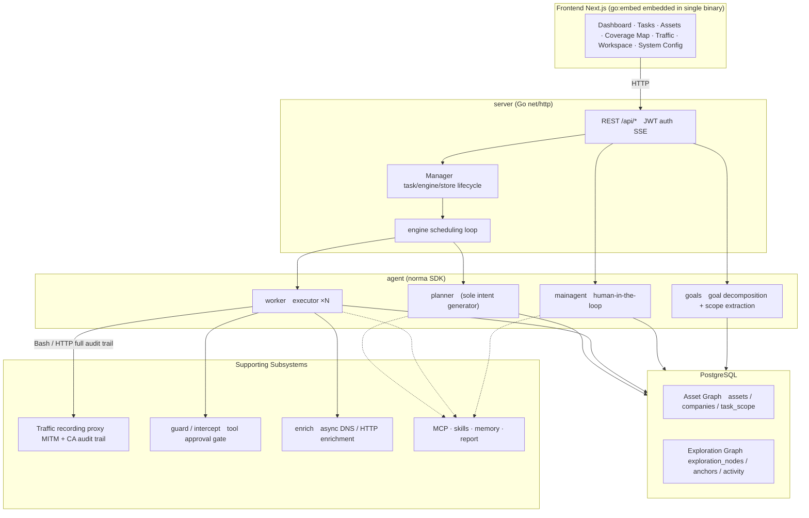
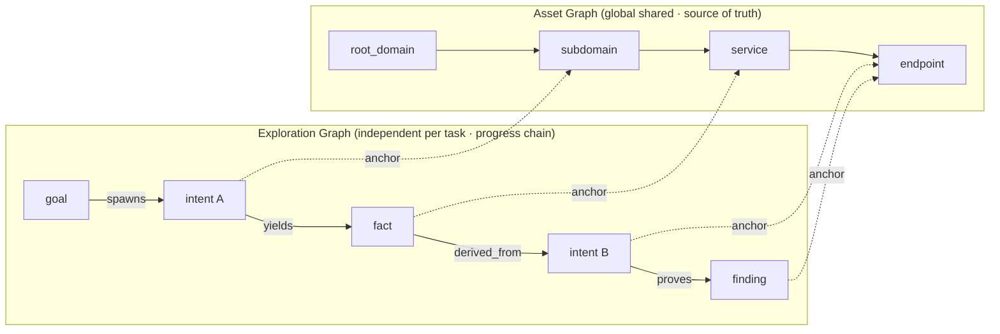
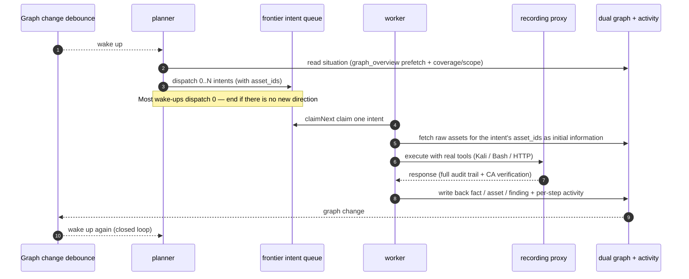
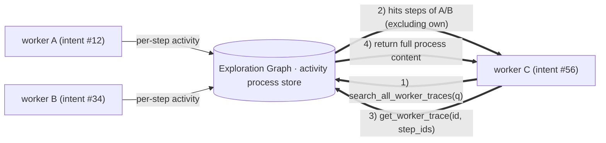
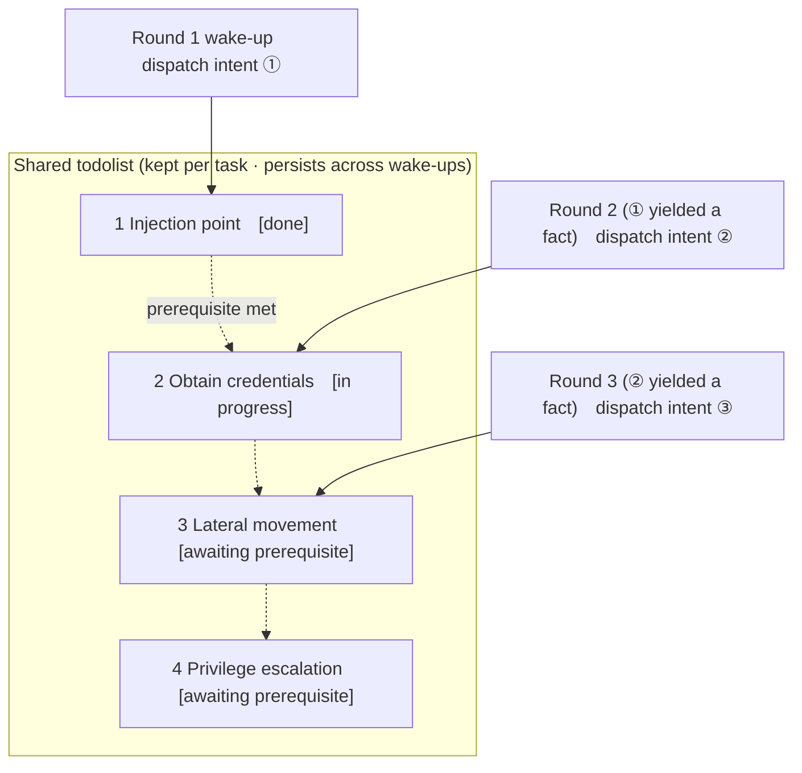

<div align="center">

# ARTEX

### LLM Multi-Agent Autonomous Penetration Testing Platform for Authorized Security Assessments

Go monolithic backend · Next.js frontend · PostgreSQL · Asset Graph / Exploration Graph dual-graph driven

**Version baseline: official ARTEX 0.3.7 release line (0.3.7 released on 2026-08-31)**

[Installation](#installation) · [Configuration](#configuration) · [Technical Architecture](#system-technical-architecture) · [Changelog](CHANGELOG.md) · [License and Disclaimer](#license-and-disclaimer)

</div>

---

> **English translation fork**: This repository is an English translation of [Core-RCE/ARTEX-original-version](https://github.com/Core-RCE/ARTEX-original-version), translated on 2026-11-19. It differs from upstream only as follows:
>
> - All Chinese text has been translated to English: UI labels and messages, LLM agent prompts and tool descriptions, log and error messages, code comments, documentation, scripts, and config comments.
> - Chinese is deliberately kept where the code matches against it: quota-error phrases returned by Chinese LLM providers, ICP filing-number parsing, CJK test fixtures, and references to Chinese-named doc files.
> - The frontend parsers for intercept messages match the English backend wording and still accept the old `[模型]` prefix, so records from existing databases display correctly.
>
> There are no other functional changes. The built-in intercept rules are seeded by name, so a database created by the Chinese version ends up with both the old Chinese rules and the new English ones; new installs are unaffected.
>
> **Version note**: The current checkout is `v0.3.7-10-gdc46457`, i.e. 10 official upstream commits after the `v0.3.7` tag. It is not a byte-for-byte identical snapshot of the `v0.3.7` tag.
>
> **Source status**: This repository holds a copy of the source code that ARTEX officially published before it went closed-source, and the **GNU AGPL v3.0** open-source license granted when that copy was obtained continues to apply. The official decision to stop publishing source code later does not retroactively revoke the open-source license of older versions that were lawfully obtained. See [LICENSE](LICENSE) for the full terms and [THIRD_PARTY_NOTICES.md](THIRD_PARTY_NOTICES.md) for third-party component notices.

## Screenshot Preview

| Dashboard (Overview / Token Usage / Activity Feed) | Task List |
| :---: | :---: |
|  |  |

| Task · Execution Process (Sessions / Tool Invocations) | Exploration Chain |
| :---: | :---: |
|  |  |

| Findings | Assets |
| :---: | :---: |
|  |  |

| Asset Coverage Map (force-directed layout · tested highlighting · node collapse/expand) |
| :---: |
|  |

| Traffic Recording | Human-in-the-Loop Chat |
| :---: | :---: |
|  |  |

| Agent Management | LLM Configuration |
| :---: | :---: |
|  |  |

| Interception Approval | Backend Logs |
| :---: | :---: |
|  |  |


---

## Asset Sync (ScopeSentry)

Asset data can be synced directly from [ScopeSentry](https://github.com/Autumn-27/ScopeSentry), saving you from collecting it again:

- On the "**Asset Sync**" page, enter the ScopeSentry address and API Key to connect the data source;
- Choose the targets and asset types to sync (domain / subdomain / IP / port / site / endpoint…) by **project** or **task**;
- Import with one click and merge by company asset scope, feeding directly into ARTEX's Asset Graph for agents to explore.

---

## Installation

> Requires a **PostgreSQL** database; exploration requires an **LLM** to be configured (`ANTHROPIC_API_KEY` or `OPENAI_API_KEY`, which can also be set in the UI).

### Method 1: One-click install script (recommended)

```bash
git clone https://github.com/Autumn-27/ARTEX.git
cd ARTEX
./install.sh
```

The script will: detect / automatically install Docker → let you choose **① All Docker** or **② Local build and run**:

- **① All Docker**: enter a Postgres password (press Enter for a random one) → automatically writes `.env` → `docker compose up -d`.
- **② Local run**: choose a database (connect to an existing one / start one with Docker) → generates `config.json` → compiles the embedded single binary with `go` → starts it.

Once installed, open **http://localhost:8787** (on first visit, go to `/setup` to set the administrator password).

### Method 2: Docker Compose (manual)

```bash
git clone https://github.com/Autumn-27/ARTEX.git
cd ARTEX
cp .env.example .env          # Fill in POSTGRES_PASSWORD, optionally ANTHROPIC_API_KEY
docker compose up -d          # Pulls the autumn27/artex image + postgres
# → http://localhost:8787
```

The image already includes common tools (ripgrep/curl/vim/npm/nmap…); `./skills` and `./data` are persisted via bind mounts.

### Method 3: Download the prebuilt binary (Releases)

Download the zip for your platform from [Releases](https://github.com/Autumn-27/ARTEX/releases). After extraction you get `artex` + `skills/` + `config.example.json`:

```bash
cp config.example.json config.json   # Fill in the database connection
./artex                              # → http://localhost:8787
```

### Method 4: Build the single binary from source

```bash
# 1) Static export of the frontend
cd web && npm ci && npm run build:static && cd ..
# 2) Copy into the embed directory
cp -r web/out server/webui/dist
# 3) Compile (the frontend is only embedded with -tags embedui)
CGO_ENABLED=0 go build -tags embedui -o artex ./cmd/artex
./artex
```

### Method 5: Build cross-platform Release archives

`build.sh` first builds and embeds the frontend, then uses the Go linker to strip debug information and packages the release files into zip archives. In Release mode, it generates zip packages for Linux amd64/arm64, macOS amd64/arm64, and Windows amd64 by default:

```bash
./build.sh --release
# Output: dist/artex-0.3.3-*.zip
```

UPX self-extracting binaries may be incompatible with some Linux kernels, virtualization environments, or security policies, so they are disabled by default. Use `ARTEX_TARGETS` to customize targets; once you have confirmed that the target runtime environment is compatible, you can explicitly pass `--upx` to shrink the binary further:

```bash
ARTEX_TARGETS=linux/amd64,windows/amd64 ./build.sh --release
./build.sh --target linux/amd64 --upx
```

---

## Updating and Upgrading

> An upgrade only replaces the program and leaves your data untouched: the Postgres data volume `pgdata`, `./data` (jwt.key / SQLite, etc.), and `./skills` are all preserved. **No manual database migration is needed**: on every startup, `artex` idempotently re-runs `schema.sql` (including `ADD COLUMN` / `CREATE INDEX IF NOT EXISTS`), i.e. "restart to migrate". It is still recommended to back up `./data` and the database before upgrading.

### Method 1: One-click update script (recommended)

```bash
cd ARTEX
./update.sh
```

The script first optionally runs `git pull` to fetch the latest code, then lets you choose **① Docker update** or **② Local build update** (corresponding to `install.sh`):

- **① Docker**: you can specify a target image tag (press Enter to keep `ARTEX_TAG` from `.env`, defaulting to `latest`) → `docker compose pull` → `docker compose up -d` (restarting with the new image migrates automatically).
- **② Local**: rebuild the frontend static output → recompile `./artex` (restart the process afterwards for it to take effect).

### Method 2: Docker Compose (manual)

```bash
cd ARTEX
git pull                       # Update compose / scripts (optional)
# To pin a version: set ARTEX_TAG=v0.2.0 in .env; if unset, latest is used
docker compose pull artex
docker compose up -d artex     # Restart with the new image → schema migrates automatically
docker image prune -f          # Clean up old images (optional)
```

### Method 3: Prebuilt binary (Releases)

Download the new version's zip from [Releases](https://github.com/Autumn-27/ARTEX/releases), stop the old process, then overwrite `artex` and `skills/` (keeping your `config.json` and `data/`) and restart:

```bash
cp -r <extracted-dir>/skills ./ && cp <extracted-dir>/artex ./
./artex
```

### Method 4: Build from source

```bash
git pull
cd web && npm ci && npm run build:static && cd ..
cp -r web/out server/webui/dist
CGO_ENABLED=0 go build -tags embedui -o artex ./cmd/artex
# Restart ./artex
```

---

## Configuration

**Database** (`config.json`, or override with the environment variable `ARTEX_PG_DSN`):

```json
{
  "database": {
    "host": "127.0.0.1", "port": 5432,
    "user": "artex", "password": "yourpass",
    "dbname": "artex", "sslmode": "disable"
  }
}
```

**LLM**: `export ANTHROPIC_API_KEY=sk-...` (or `OPENAI_API_KEY`); it can also be entered on the "LLM Configuration" page in the UI.
Optional: `ARTEX_LLM_PROVIDER` / `ARTEX_LLM_MODEL` / `ARTEX_LLM_BASE_URL` / `ARTEX_LLM_PROXY`.

**Concurrency**: The number of work agents per task is configured under "System Settings" (default 3).

**Common flags**: `./artex -addr :8787 -proxy :8788` (`-addr` is frontend + API, `-proxy` is the traffic recording proxy).

---


## Development

```bash
./dev.sh    # Backend (:8787) + traffic proxy (:8788) + frontend next dev (:5173) → http://localhost:5173
```

- Backend: `go run ./cmd/artex` (without `-tags embedui` the frontend is not embedded)
- Frontend: `cd web && npm run dev` (`/api` is reverse-proxied to the backend, with hot reload)
- Tests: `go test ./...`
- Mock preview (no backend): `cd web && NEXT_PUBLIC_MOCK=1 npm run dev`

---

## System Technical Architecture

ARTEX is an **autonomous penetration testing system driven by multiple LLM agents**: a Go monolithic backend (with the Next.js frontend embedded) + PostgreSQL, with agent capabilities provided by the [`norma`](https://github.com/Autumn-27/norma) SDK (`agentcore` / `tool` / `permission` / `harness` / `memory` / `transcript`). At its core is the **dual-graph architecture**, along with two autonomy mechanisms built around it: **process-level information exchange between workers** and the **planner's multi-round shared todolist for stable attack chains**.

### Overall Layering



| Layer | Responsibility |
| --- | --- |
| **Frontend** | Next.js static export, embedded into the single binary via `go:embed`; visualizes tasks / assets / exploration chains / coverage map, with human-in-the-loop chat |
| **server** | `net/http` routing + JWT auth + SSE; `Manager` hosts the lifecycle of tasks, engines, and DB stores |
| **engine** | One `plannerLoop` + N worker goroutines per task; intent claiming, timeout/pause/drain |
| **agent** | goals / planner / worker / mainagent; `ToolSet` exposes the dual graph as LLM tools |
| **db** | Postgres persistence of the dual graph (pgx); the schema is created idempotently on every startup via `go:embed` |
| **Supporting** | Recording MITM proxy, approval gate, async enrichment, MCP/skills/memory/reports |

### Dual-Graph Architecture: Exploration Graph + Asset Graph

The system splits "**what the target is**" and "**how far it has been tested**" into two independent graphs that are connected through anchors:

- **Asset Graph (global, shared)**: A single source of truth for assets shared across tasks. Nodes are `root_domain / subdomain / ip / service / app / endpoint`, and belong to a company; the parent-child relationships (domain → subdomain → service → endpoint) and deduplication keys are all computed by the program, while agents only submit raw information.
- **Exploration Graph (independent per task)**: The "thinking and progress" process of a single task. Nodes are `goal / intent / fact / finding / hint`, connected by edges such as `spawns / derived_from / yields / proves` into a **lineage chain**, answering "which direction was derived from which facts, and what did it produce".
- **The two graphs are connected by anchors**: `exploration_anchors(node_id, asset_id)` anchors intents / facts / findings to specific assets. This lets you see, from an "exploration direction", which assets it targeted, and also, from a given asset, look up which intents tested it in this task and which facts were derived. This also underpins **asset test coverage** and the **Asset Coverage Map** (in-scope assets + tested highlighting).



> Division of labor: the **planner** reads the situation from the Exploration Graph, judges the goal, and only dispatches **intents** into the frontier when there is a new, uncovered direction; a **worker** claims **one intent**, executes it with real tools, writes the new assets/facts/findings back to both graphs, and then stops. The Asset Graph is shared fact; the Exploration Graph is the per-task progress chain.

### Engine and Intent Lifecycle (the Closed Loop of One Exploration)

The engine is an **event-driven** closed loop: as soon as the graph changes, the planner is woken up; the planner dispatches intents, workers claim and execute them and write back, and the write-back triggers the next round, until the goal is proven (`prove_goal`).



### Process-Level Information Exchange Between Workers

In a deep exploration, many valuable observations (an error message, a response snippet, a hidden parameter) appear during one worker's **execution process** without necessarily being written up as a formal fact. To avoid duplicated effort and let workers along the chain stand on each other's shoulders, workers can **search across work processes**:

- `search_all_worker_traces(q)`: search by keyword within the **execution processes of other works in this task** (automatically excluding the steps of the worker's own intent); hits carry an `intent_id`;
- `list_worker_traces` / `get_worker_trace(intent_id, step_ids=[…])`: first see which works have run, then fetch the full content of specific steps of a given work for detailed exchange.

This way, even if the Exploration Graph has no corresponding fact yet, later workers can reuse observations from other workers' processes: **information flows between workers at the granularity of the "execution process"**, while the boundary is unchanged (each worker still only does the one intent it claimed).



### Planner Multi-Round Shared Todolist → Stable Attack Chains

Real attack chains are often **multi-step sequences with dependencies** (e.g. find an injection point → obtain credentials → lateral movement → privilege escalation), and dispatching them all in parallel at once just makes a mess. The planner therefore holds a **planning todolist that is kept per task and shared across wake-ups**:

- The planner is event-driven: it is woken up whenever the graph changes, but **every wake-up is a brand-new session**. The shared todolist lets it **record a serial exploitation chain once**, then **dispatch intents step by step according to dependencies** over subsequent rounds, rather than expanding the entire chain up front in a single round;
- Each round, it dispatches an intent only for the next step whose "prerequisite steps are complete and whose dependent facts already exist", and updates the list as progress is made (marking steps already satisfied by facts as complete).



As a result, even in an "event-driven + stateless session" environment, the attack chain still **advances stably, without repetition or misordering**. This is the key to ARTEX being able to autonomously complete multi-step exploitation chains.

---
## References

https://github.com/oritera/Cairn


## License and Disclaimer

### Open-Source License

This project is licensed under the **GNU Affero General Public License v3.0 (AGPL-3.0)**. See the [LICENSE](https://github.com/mhtsec/ARTEX/blob/main/LICENSE) file in the repository root for the full terms.

This means anyone may freely use, modify, and distribute this project, but **derivative works must likewise be open-sourced under AGPL-3.0**; in particular, **if you modify this project and provide it to users over a network (e.g. deployed as an online service), you must also make the corresponding complete source code available to those users**.

> ⚠️ **Important notice**: The open-source license itself does not restrict how the software is used. The "Usage Restrictions" and "Disclaimer" below are additional terms and a formal statement from the author to users. Please be sure to comply with them.

**ARTEX is intended solely for personal learning, code research, and local technical verification. It must not be used to launch actual tests against any online system or website.**

### Permitted Use

- It may only be used to **read, study, and research the source code of this project**, and to perform technical principle verification in a **local, isolated environment**;
- It is suitable for non-offensive purposes such as personal learning, academic research, and code review.

### Prohibited Activities

- **It is strictly forbidden to use this tool to scan, probe, exploit, or attack any website, online service, or networked system** (regardless of whether authorization has been obtained or whether the assets are your own);
- It is strictly forbidden to use this tool for any actual penetration testing, offensive/defensive exercises, or production environments;
- It is strictly forbidden to use this tool for illegal intrusion, data theft, extortion, denial of service, or any destructive or criminal activity;
- It is strictly forbidden to use this tool to engage in conduct that violates the laws and regulations of your country/region.

### Compliance Responsibility

Users must comply on their own with all laws and regulations of their country/region regarding cybersecurity, data protection, and computer crime (in mainland China, including but not limited to the Cybersecurity Law, the Data Security Law, the Personal Information Protection Law, and related judicial interpretations). **All legal liability and consequences arising from the use of this tool are borne solely by the user.**

### Disclaimer

This project is provided "AS IS", without any express or implied warranty. The author and contributors shall not be liable for any direct or indirect loss, data loss, system damage, or legal dispute arising from the use of this tool (whether or not it is used properly). **By downloading, installing, or using this project, you acknowledge that you have read, understood, and agreed to all of the above terms.**
